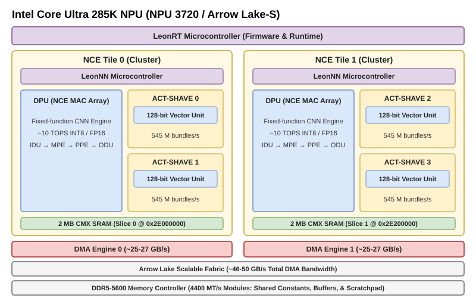

# Intel AI Boost NPU (NPU 3720, "37XX") development reference

Hardware, instruction set, compiler and driver behavior of the NPU in the
Core Ultra 285K (Arrow Lake-S, PCI `8086:AD1D`). Every statement was read
from the compiler's NPU37XX firmware headers (`npu_compiler` tag
`npu_ud_2025_44_rc1` = VCL 7.4, the compiler of driver 32.0.100.4404),
established by black-box interoperability analysis (§2 "Provenance"), or
measured on the device.

## 1. Hardware

| Block | Per device | Notes |
|---|---|---|
| NCE tiles ("clusters") | **2** | Each tile has 1 DPU, 1 SNN, 2 ACT-SHAVEs and 1 CMX slice. One tile handles one cluster's share of a multi-cluster op |
| DPU (NCE MAC array) | 1 per tile | Fixed-function convolution engine. ~10 TOPS int8 inside a task, both tiles together, and fp16 at about a third of that. Accumulates in int32 / fp32. The register groups are IDU (input) -> MPE (MAC array) -> PPE (post-processing) -> ODU (output) |
| SNN (`SHAVE_NN`) | 1 per tile | Scalar SHAVE, since its assembler target `3720xx-nn` has no vector unit |
| ACT-SHAVE | 2 per tile, **4 total** | Programmable VLIW DSPs with 128-bit vectors (§3). Run every non-DPU op (eltwise, norms, softmax, exp, convert, ...). 545 M bundles/s each |
| CMX (SRAM) | **2 MB per tile** | Slice 0 at `0x2E000000`, slice 1 at `0x2E200000`. 63 KB metadata (descriptor rings), 14 KB SHAVE stacks, 1 KB scratch, **1936 KB workspace** for tensors (the compiler plans with 0.9 x of it) |
| DMA engines | **2** | DDR↔CMX and CMX↔CMX. ~25-27 GB/s each, **~46-50 GB/s total**, and ~5-6.5 us per DMA task. Optional BTC weight decompression |
| Management cores | LeonRT, LeonNN | Run the NN runtime firmware (`npu27_firmware.bin`), which handles descriptor rings, barriers and kernel invocations |
| HW barriers | | A task waits for barriers and updates barriers, and a barrier counts its producers and consumers. Barriers are the only ordering mechanism between engines |
| Clock | 1.6 GHz | Holds under sustained load. The turbo property and queue priority do not change it |
| Memory | none of its own | Shares host DRAM. Graph constants, bound inputs and scratch are host memory |

The descriptor ring sizes in the CMX metadata (`vpu_cmx_info_37xx.h`) are DMA tasks 256,
**DPU invariants 32**, DPU variants 256, kernel ranges 32, kernel invocations
64. The records are `VpuDPUVariant` 64 B and `VpuActKernelInvocation` 64 B. The
invariants of both tiles share one 32-entry ring, and so do the ACT-SHAVE
invocations. A ring is reloaded in halves of 16, and half k + 2 is loaded only
once every task of half k has had its `clean_after` barrier consumed. A
schedule in which one barrier is shared by tasks of three ring halves
therefore deadlocks.

### Throughput

| Operation | Rate |
|---|---|
| DPU, inside a task | ~10 TOPS int8, idle ~30 % of the time between tasks on large FCs |
| FC, int4 per-row weights, 256 rows of activation | **11.3 TOPS** with constant weights, 7.7 with the weights as plain graph inputs (§4, swizzling) |
| FC, int4 per-row weights, 1 or 4 rows | 42 GB/s of weights, which is DMA-bound, so 4 rows cost the same as 1 |
| FC, int8 weights, static int8 activation, K 5120 x N 17408 | 5.2 TOPS at 256 rows, 6.1 at 512, 7.1 at 1024, 7.4 at 2048 |
| FC, int4 weights quantized in groups of 128 | 2.4-2.6 TOPS at 128-256 rows, 34-36 GB/s at 1 row, 22-24 GB/s at 4 |
| FC, f16 x f16 | 3.5 TFLOP/s at 512 rows |
| Small MatMul as one DPU task per tile | ~3.5-5 us, nearly flat in size, with (64 to 256, 64, 64) at 3.6-3.8 us and (128, 128, 128) at 8.4 us |
| Dependent DPU op whose input is already in CMX | starts ~2.5 us after its producer |
| One slice of an unrolled batched MatMul (DMA in / out + concat) | ~5-6.5 us |
| Transposing a computed operand (DPU MaxPool + 2 DMAs) | ~47-60 us |
| Small SHAVE eltwise task | ~50 us, with ~2.7 us of preamble per kernel invocation |
| RMS norm of [256, 5120] on the SHAVEs | 0.89 ms |
| Graph launch (tiny graph) | 0.28 ms minimum, 0.52 ms median wall time for 0.03 ms of device time |
| Mutable command-list argument update | 0.03-0.14 ms |

DMA, DPU and SHAVE tasks of one graph mostly run in turn rather than
together (§5, scheduler), so the costs of small ops add up serially.
Measurements taken while the host runs a heavy job are invalid, because DRAM and the
package power budget are shared.

## 2. Toolchain

| Stage | Tool | Input -> output |
|---|---|---|
| Kernel -> assembly | **ours**, `npu::shave::dsl` (`shave build K.sk`), the language of `SHAVE-DSL.md` | `.sk` -> `.s` |
| Assembly -> object | **ours**, `npu::shave::asm` (`shave as`) | `.s` -> `.o` (ELF32 relocatable, `EM_SPARC`) |
| Link | **ours**, `npu::shave::link` (`shave ld`) | `.o` -> ELF32 executable at `0x1D000000` |
| Graph compile | the driver through Level Zero, or a build of `npu_compiler` | OpenVINO IR -> native graph blob (ELF) |

The kernel compiler, the assembler and the linker are ours
(`crates/npu/src/shave`, command line `cargo run --release -p npu --example
shave -- build KERNEL.sk|KERNEL.s OUT.elf`), and building a kernel needs no
vendor tool. The kernels are written in the kernel language (`SHAVE-DSL.md`,
`shave/softmax_lse.sk`, `gnorm.sk`, `trinv.sk`, `softmax_q8.sk`,
`hcmix.sk`, `l2n.sk`). The compiler schedules the bundles, keeps the latencies and the
rules of §3.2 and assigns the registers, and `npu::shave::mach` runs the
result on the host with the processor's timing. The encoding is in §3.10.
Limits of the assembler and the linker:

- The assembler knows every instruction form of the target
  (`src/shave/isa.tbl`, 2588 lines for 1493 mnemonics, §3.7), except for three
  kinds of operand. These are a label where `BRU.RPL` / `BRU.RPS` and `LDA` / `STA`
  take one (their immediate forms are in the table, and `BRU.BRA`, `LDIL` and
  `LDIH` take labels), the PEU slot mask in letters (`PEU.PCCX 1 [1V]`, though as
  a number it is), and an ignored trailing operand (`VAU.DP4A v v v 4` is
  `VAU.DP4A v v v V_ACC0`).
- It checks resource conflicts between cycles (`conflicts.tbl`) only among
  the 106 forms the kernels and the kernel language use, and no latencies.
- The linker takes objects, not archives, so a kernel cannot call into a
  library.

### Provenance (clean-room boundary)

The SHAVE toolchain is an independent implementation. What it needs of the
processor is recorded in this repository as **functional facts, in our own
format and words**, namely the instruction set's mnemonics and operands, where each
operand's bits go (`isa.tbl`), which instruction pairs share a resource
(`conflicts.tbl`), the latencies and rules of §3, and the object and
executable layout the kernel loader expects (§3.9, §3.10). They were
established by black-box interoperability analysis, which means observing which input
the vendor's toolchain accepts and what it produces, and running code on
the device. That is what the EU Software Directive (2009/24/EC Art. 5(3),
Art. 6) and German law (§§ 69d(3), 69e UrhG) permit a lawful user for
interoperability. The interface facts themselves (instruction set,
programming-language syntax, data formats) are not protected expression
(CJEU C-406/10, *SAS Institute*).

Rules that keep it so:

- **Nothing of the vendor's in the tree.** There are no tool binaries, libraries,
  headers, source, scripts that drive them, generated assembly, objects or
  byte dumps of their output, error texts, internal names or version
  strings, and no instructions for obtaining the tools.
- Tests hold the toolchain against **its own recorded output**
  (`tests/shave.rs`, `isa.samples`) and against numerical references in
  the emulator (`tests/shave_dsl.rs`). The ground truth is the device
  (`scripts/sktest.py`, `scripts/shavedev.py`, both on our own toolchain).
- A new instruction form is added from a test on the device
  (`scripts/shavedev.py`) or from the public `npu_compiler` sources, and
  written into `isa.tbl` / `conflicts.tbl` as a fact.

The `npu_compiler` stages (MLIR) are OpenVINO IR -> `vpux-translate --import-IE` ->
**IE** (graph-level fusion and quantization with `FuseRMSNorm`,
`UnrollFullyConnected`, `MatMulInputsTo2d`, `ConvertWeightsToU8`) -> **VPU**
(NCE ops, multi-cluster strategy, tiling) -> **VPUIP** (buffers, copies,
`OptimizeCopies`, memory scheduler, spills) -> **VPURT** (barriers, task
queues) -> **VPUMI37XX** (descriptors) -> ELF (`vpux-opt
--lower-VPUIP-to-ELF`, `vpux-translate --export-ELF`). Target flag
`--vpu-arch=NPU37XX`, and the middle stages run as `vpux-opt
--default-hw-mode=<options>`. A build at the tag above produces blobs
byte-identical to the driver's.

## 3. ACT-SHAVE

### 3.1 Processor

| Property | Value |
|---|---|
| Bundle | One instruction word holds up to **8 operations, one per unit**, namely `PEU`, `BRU`, `LSU0`, `LSU1`, `CMU`, `IAU`, `SAU`, `VAU`, written `A \|\| B \|\| ...`. Using a unit twice is an assembler error. Scheduling is static |
| Units | `VAU` vector arithmetic, `SAU` scalar arithmetic, `IAU` integer arithmetic, `CMU` compare / move / convert, `LSU0` / `LSU1` load / store, `BRU` branch, `PEU` predication |
| Encoding | Variable length, with `NOP` at 1 byte, one operation at 4-5 bytes, a 5-unit bundle at 18 bytes and an 8-unit bundle at 37 |
| Cycle | **1.836 ns = 545 M bundles/s**, whatever the bundle holds. Every unit accepts a new operation each cycle, including `VAU.SIGM` and `SAU.DIV`. A 5-unit bundle costs 1.12 cycles |
| Shared datapath | SAU and VAU share adders and multipliers, so `SAU.x \|\| VAU.y` is rejected for add / sub / mul / logic / `VAU.SIGM`. `SAU.DIV` or `SAU.SQT` beside a VAU operation, and `IAU.MUL` beside `VAU.MUL`, are accepted |
| Registers | `i0`-`i31` (32-bit) and `v0`-`v31` (128-bit). `v3.1` is element 1 at the instruction's element size, which is a 64-bit half for `LSU0.LDO.64` and a 32-bit lane for `CMU.CP.32`. SAU works on `i` registers and on vector elements |
| Accumulators | Two per arithmetic unit, `V_ACC0`, `V_ACC1`, `S_ACC0`, `S_ACC1` |
| Control registers | Read with `CMU.CPTI i NAME`, written with `CMU.CPIT`. `P_SVID` is the SHAVE id, **0x20-0x23** on the four ACT-SHAVEs. `P_CFG` reads 9, `P_GPI` 0x01010005 |
| Types | VAU has 16 x i8 / u8, 8 x i16, 4 x i32, 8 x f16, 4 x f32, and `u8f` (u8 as a fraction). SAU has one element of the same types |
| Calling convention | `i18` first argument, `i19` stack pointer, `i30` return address (`BRU.JMP i30`). `i20`-`i28` and `v24`-`v26` are callee-saved, and a leaf function may use `i0`-`i17` and `v0`-`v23` freely |
| Branches | `BRU.BRA label`, `BRU.JMP ireg`. **6 delay slots**, so the six bundles after a taken branch execute |
| Predication | `PEU.PC1C cond` (`EQ`, `NEQ`, `LT`, `GT`, ...) makes **its whole bundle** conditional on the flags of an earlier `CMU.CMZ` / `CMU.CMII`, a compare in that same bundle included. Flags are usable in the next cycle. A conditional branch is `PEU.PC1C cond \|\| BRU.BRA label` |
| Subnormals | f16 subnormal inputs are flushed to zero by `VAU.MUL` and by the f16 -> f32 conversion. A raw bit copy keeps them |

### 3.2 Latency

Cycles from issuing an instruction until another instruction reads its
result. The assembler does not check this, and a consumer issued too early
reads the old value. `VAU.ADD.i32 v1 v1 v2` in consecutive cycles advances
`v1` on every other add. Hand-written code covers the gap with `NOP n`.

| Cycles | Instructions |
|---|---|
| 1 | `IAU.ADD` / `SUB` / `AND` / `SHL` / `BSR` / `ONES`, `VAU.AND` / `XOR` / `NOT` / `ABS`, `CMU.CP.32`, `CMU.CP.128`, the widening copies (`.i8.i16`, `.i16.i32`, `.f16.f32`), the splat `CMU.CP.128.32.r`, `CMU.ALIGNVEC`, `LSU0.LDIL` |
| 2 | `IAU.MUL`, `IAU.LMULH`, VAU / SAU integer `ADD` / `SUB` / `IADDS` / `AVG` / `SHL`, `CMU.MIN` / `MAX` (all types), `CMU.SHFL`, `CMU.CP.*.i32.f32`, `.f32.i32s` (truncates toward zero), `CMU.CP.128.f16.i16s` (truncates), `.i16.f16`, `CMU.CP.64.f16.u8fs` (x * 255 to nearest, saturating), `CMU.CP.128.u8f.f16` (`shavedev.py lat q8`), `SAU.SUMX.i32` |
| 3 | VAU / SAU **float `ADD` / `SUB` / `MUL`** (f16 and f32), integer `MUL` / `IMULS`, `ADIFF`, `DP4`, `VAU.ACCPW` |
| 4 | `VAU.MACPW.i32` |
| 5 | `VAU.SIGM` / `TANH` / `EXP` / `LOG` / `SQT`, `SAU.SQT` / `RQT` / `RCP` / `SIN` / `COS` / `ATN` / `EXP` / `EXP2` / `LOG` / `LOG2` / `SIGM` / `TANH`, `SAU.SUMX.f32`, `VAU.MACPW` f16 / f32 |
| 7 | Loads `LSU0.LDO.32`, `LD.64` and the converting `LD.128.x.y` |
| 8 | `LSU0.LD.128` (its low half after 7), `SAU.DIV.f16` |
| 12 / 14 / 15 | `SAU.DIV.f32` / `SAU.DIV.i32` / `SAU.MOD.i32` |

**Rules beyond latency** (measured on the device, and `scripts/sktest.py` runs
the test kernels). Each one, broken,
gives wrong data or a loop that does not end, which loses the device:

| Rule | Measured |
|---|---|
| **One result per unit, register file and cycle.** Two results of one unit for `i` registers (or for `v` registers) that arrive in the same cycle lose one of them | `LSU0.LDO.32 i3 ..` in cycle 1 and `LSU0.CP.32 i4 i1` in cycle 7 both arrive in cycle 8, and `i4` keeps its old value. With the copy on the CMU, or one cycle later, it is right. An `i` result beside a `v` result of the same unit is fine (`LSU0.CP.32` arriving with an `LSU0.LDO.64`) |
| **A 128-bit load or store takes its LSU for two cycles.** The low half arrives after 7 cycles, the high half after 8 | `LSU0.LD.128` followed in the next cycle by any load or store on `LSU0` makes both wrong. On the other LSU in either cycle (two `LD.128` in one bundle included), both are right. `ST.128` in consecutive cycles on one LSU is wrong |
| **`CMU.MAX` rewrites the condition flags** (and `MIN`, by assumption) | Of 27 instructions tried between `CMU.CMII` and `PEU.PC1C` (CMU copies / splats / `ALIGNVEC`, IAU, VAU incl. `EXP`, SAU, LSU loads / stores / immediates), only `CMU.MAX.F16` changed the outcome |
| **Compare directly before the branch** | A compare 28 cycles ahead of its `PEU.PC1C \|\| BRU.BRA`, with loads, stores and VAU work in between, lost the device, while the same kernel with the compare in the cycle before the branch runs. Compiled code always has it there. What rewrites the flags over that distance was not found |
| **Shared ports. `CMU.CMII` not beside an `LSU1` load or store** (and `CMU.ALIGNVEC` not beside `SAU.SUMX`) | `CMU.CMII.U32 i17 i16 \|\| LSU1.LDO.32 i3 i2 0` gives `i3` an address-like value (`2e054040`) instead of the word. With `LSU0`, with `CMU.CMZ`, or one cycle apart, it is right. `CMII` reads its second operand through LSU1's port of the integer register file, so the two share a read port. A kernel with this bundle in front of a loop lost the device. `src/shave/conflicts.tbl` holds the pairs of the forms in use that share a resource 0-8 cycles apart. Besides these two, it has only what the rules above already say (the units' write ports, SAU beside VAU, `MAX` / `MIN` before a compare) and pairs with instructions our compiler does not emit |
| A register with a result on its way keeps its old value until the arrival | Relied on by compiled code (VAU) and by ours also for loads, as in four loads into `v6` in consecutive cycles, each read in the cycle it arrives |
| Operations beside a conditional branch | `PEU.PC1C` makes the whole bundle conditional. `PEU.PCCX cond mask` makes the branch conditional and of the other units those whose mask bit is set, with bit 0 IAU, 1 SAU, 2 CMU, 3 VAU, 4 LSU0, 5 LSU1 (from compiled code, and our kernels set the bits of the units not in the bundle, as it does) |

### 3.3 Multiply-accumulate

| Instruction | Effect |
|---|---|
| `VAU.MACPZ.t a b V_ACCn` | acc = a * b |
| `VAU.MACP.t a b V_ACCn` | acc += a * b |
| `VAU.MACPW.t d a b V_ACCn` | acc += a * b, then d = acc |
| `VAU.MACN.t`, `MACNZ`, `MACNW` | the same with acc -= a * b |
| `VAU.ACCP.t a V_ACCn`, `ACCPZ`, `ACCPW d a V_ACCn` | acc += a (and the `Z` / `W` variants) |

Types f16, f32, i8-i32, u8-u32. The same instructions exist on `SAU` with
`S_ACC0` / `S_ACC1`. **An accumulator takes one accumulation every two
cycles**, so of three issued in consecutive cycles the middle one is lost.
Alternating `V_ACC0` and `V_ACC1` issues one per cycle. Separate `VAU.MUL` +
`VAU.ADD` take two VAU slots and 3 + 3 cycles per term.

### 3.4 Transcendentals

`VAU.SIGM` / `TANH` / `EXP` / `LOG` / `SQT` (8 x f16) and the scalar
`SAU.SQT` / `RQT` / `RCP` / `SIN` / `COS` / `ATN` / `EXP` / `EXP2` / `LOG` /
`LOG2` / `SIGM` / `TANH` (one f16 element) are hardware operations of 5
cycles, within 6e-4 relative of the exact value. The kernel language
reaches them as functions (`SHAVE-DSL.md`).

### 3.5 Memory

| Address | What |
|---|---|
| `0x1C000000` | The runtime's own SHAVE code (a kernel returns into it) |
| `0x1D000000` | Kernel `.text` |
| `0x2E000000`, `0x2E200000` | CMX slice of tile 0 / 1. Stack of the tile's SHAVE k near slice + `0x2728` + k x `0x1C00` (7 KB each), with tensors above |
| `0x80030000` + n x `0x100` | The `params` block of invocation n, outside CMX |

A kernel can load from all four regions. Nothing protects memory, so a store
through a wrong pointer loses the device (`0x70000001`), but the next graph runs
again.

| A loop of bundles, each holding | Cycles per bundle |
|---|---|
| one store, 32- or 128-bit | 1.0 |
| one load from CMX or the stack (`LSU0.LDO.32`, `LSU0.LD.128`) | 1.16 |
| a vector as two 64-bit halves, `LSU0.LDO.64 \|\| LSU1.LDO.64` | 1.5 load, 1.3 store |
| two 32-bit loads, `LSU0 \|\| LSU1` | 1.9 |
| one load from `params` or from the code region | 2.0 |
| one 32-bit load or store while the tile's other SHAVE does the same | 1.6-1.9 |

- **Code that is new to the instruction cache costs ~15 cycles per bundle**
  (the code region is slow memory, see the table). 4000 bundles of `IAU.ADD
  || LSU0.LDIL` in front of a kernel add 113 us per invocation as
  straight-line code and 8.5 us as a loop of 40 bundles run 100 times. A
  kernel's size alone costs nothing (26 KB of code never run takes the same time),
  and a branch over 9 KB works in both directions. So unrolling pays only
  while the hot code stays small. `trinv.sk` with its 16 rows unrolled (12
  KB, half the cycles in the emulator) is slower than its 2 KB loop form.
- SHAVEs on different tiles do not slow each other, and 128-bit accesses of two
  SHAVEs on one tile stay at 1.0-1.2.
- `LSU0.LD.128 v a` / `LSU0.ST.128 v a` move a whole vector with one LSU.
- Converting loads are `LSU0.LD.128.f16.f32` (4 x f16 -> f32), `.i8.i16`,
  `.u8.f16`, `.i4.i8` (16 nibbles -> sign-extended bytes).

### 3.6 Operand swizzle

An `LSU` slot can carry a modifier for the **first source operand** of the
arithmetic operation in the same bundle, instead of a load or store, as in
`LSU0.SWZMV4.word [3210] [UUUU] || VAU.OR v3 v1 v2`. `SWZMV*` applies to the
VAU operation, `SWZMC*` to the CMU one (not to `CMU.CP`), `SWZMS*` to the
SAU one.

| Part | Meaning |
|---|---|
| `4.word` | the four 32-bit lanes of the vector |
| `4.byte` | the four bytes inside every 32-bit lane |
| `8.L`, `8.H` | the four 16-bit elements of the low / high 64-bit half |
| first bracket | source element for each position, highest position first. `[3210]` is the identity, `[0123]` reverses, `[0000]` replicates element 0 |
| second bracket | per position, highest first, `U` uses the element, `V` its bitwise NOT, `Z` zero, `1` the integer 1 |

Both brackets hold four entries in every form. With `v1` = bytes `00..0f`
and `v2` = bytes `10..1f`, `SWZMV4.word [3210] [UVZ1] || VAU.OR v3 v1 v2`
gives lanes `(1 | v2[0], v2[1], ~v1[2] | v2[2], v1[3] | v2[3])`.

### 3.7 Mnemonics

The target has 1495 mnemonics, and there are no 256- or 512-bit forms. All
1495 are in `src/shave/isa.tbl` with every operand list they take
(`BRU.NOP` and `BRU.INC` are names of `NOP`), so
that file is the full list of what the table below summarizes. Named
registers (`CMU.CPTI i1 C_CMU0`) are `T0`-`T31`, also called `B_IP_0` `B_LBEG`
`B_LEND` `B_MREPS` `B_STATE` `B_RFB` `V_ACC00`-`V_ACC03` `V_ACC10`-`V_ACC13`
`NONE` `I_AE` `F_AE` `C_CSI` `C_CMU0` `C_CMU1` `B_SREPS` `S_ACC0` `S_ACC1`
`C_STATE` `ISR_STAT` `ISR_RA` `ISR_SA` `P_CFG` `P_SVID` `P_VERS` `P_GPI`
`P_GPR` in that order. The accumulator operand of `ACC*` / `MAC*` / `DP4A*`
is `V_ACC0` / `V_ACC1` (VAU) or `S_ACC0` / `S_ACC1` (SAU). The conditions are
`NONE EQ GT GTE LT LTE NA O UO NEQ`. Float immediates (`VAU` / `SAU`
`ADD` / `SUB` / `MUL` `.f16` / `.f32 x y 0.5`) are plus or minus 0.5, 1.0,
2.0, 3.0, 10.0, 128.0, 255.0. An element index is one digit (`v1.12` is
read as `v1.1`). Operands are separated by spaces
or commas, destination first, and suffixes are case-insensitive. Instructions in
bold were executed on the device with correct results, and the others are
accepted by the assembler.

| Unit | Mnemonics | Operands, suffixes |
|---|---|---|
| VAU | **`ADD` `SUB` `MUL`** | `vD vA vB`, `.f16 .f32 .i8 .i16 .i32 .u8f` |
| VAU | **`ABS`**, **`AND` `XOR` `NOT`** `OR`, **`ADIFF` `IADDS` `IMULS` `AVG` `SHL`** `ISUBS` `ILMULH` `SHR` `SHD` `ROL` `ADDCI` `SUBCI` | saturating and shift forms `.i8`-`.u32`, and `AVG` / `SHL` / `ROL` `.x8 .x16 .x32` |
| VAU | **`MACP` `MACPZ` `MACPW` `MACNW` `ACCPZ` `ACCPW`** `MACN` `MACNZ` `ACCP` `ACCN` `ACCNZ` `ACCNW` | §3.3 |
| VAU | **`SIGM` `TANH` `EXP` `LOG` `SQT`** | `vD vA`, 8 x f16 |
| VAU | **`DP4`** `DP4M` `DP4A` `DP4AZ` `DP4AM` `DP4AMZ` | 16 x i8 -> 4 x i32 dot products, and the `A` forms accumulate |
| VAU | `ALIGNBYTE` `CMB` `ONESX` `ZEROSX` | |
| SAU | **`ADD` `MUL` `DIV` `MOD`** `SUB` `ABS` `ADIFF` `FRAC` and the VAU integer set | `iD iA iB`, with `DIV` in `.f16 .f32 .i16 .i32 .u16 .u32` |
| SAU | **`SQT` `RQT` `RCP` `SIN` `COS` `ATN` `EXP` `EXP2` `LOG` `LOG2` `SIGM` `TANH`** | `iD vA.0`, one f16 element in, f16 in the low half of `iD` |
| SAU | **`SUMX`** `SUMC` `ANDX` `ORX` `XORX` `ONESX` `ZEROSX` | `iD vA` reduces a vector (`SUMX.f32`, `.i32`, ...) |
| SAU | **`DP4`** `DP4A*` `MACP*` `ACCP*` | accumulators `S_ACC0` / `S_ACC1` |
| IAU | **`ADD` `SUB` `MUL` `SHL` `AND` `LMULH` `BSR` `ONES` `OR` `INCS`** `XOR` `NOT` `SHR.i32/.u32` `SHD` `ROL` `LMULL` `MULSI` `MULSU` `ADDSI` `ADDSU` `SUBSI` `SUBSU` `ABS` `AVG` `MINI` `MAXI` `MINU` `MAXU` `CLAMP` `CLAMP0` `BSF` `ZEROS` `RVRS` `FEXTU` `FEXTI` `FINS` `ALIGN` `CMPI` `DECCMP` | `iD iA iB\|imm` |
| CMU | **`CP.32` `CP.128`**, **`CP.128.<from>.<to>`** (executed forms are `.f16.f32 .i32.f32 .f32.i32s .i16.i32 .i8.i16 .32.r`) | 72 conversions of 128 bits, more of 32 and 16, `s` = saturating, `.r` = replicate |
| CMU | **`MIN` `MAX`** `CLAMP` `CLAMP0` `CLAMPAB` | `vD vA vB`, `.f16 .f32 .i8`-`.u32` |
| CMU | **`CMZ` `CMII`** `CMVV` `CMIIABS` `CMVVABS` `CMPI` `CMTI` | compares that set the flags `PEU` reads |
| CMU | **`ALIGNVEC`** `ROTVEC` `SHLVEC` `SHRVEC` `SHLIV` `SHRIV` `VSZM` `VILV` `VDILV` `VNZ` `VSIGN` `LUT` `CMASK` `TP4L` `TP4R` | vector shuffles, swizzle (`VSZM.byte v v [3210]`), interleave, table lookup |
| CMU | **`CPTI`** `CPIT` `CPZT` | control-register read / write / clear |
| CMU | **`CPZI` `CPZV`** | `reg n`, n from 0 to 3, clears `reg` and the n registers after it (`CMU.CPZV v2 3` clears `v2`-`v5`) |
| CMU | **`CPVRC`** | `vD.e vA` copies the highest 32-bit lane of `vA` into lane `e` of `vD` |
| CMU | **`SHFL`** | `vD vA W E K` (powers of two up to 128, in bits). In every `W`-bit window of `vA`, the `E`-bit elements are reordered to indices 0, K, 2K, ..., then 1, K + 1, .... This is a K-way de-interleave, and with K = half the element count the interleave of the window's two halves. `CMU.SHFL v v 128 8 4` on bytes 0..15 gives 0 4 8 12 1 5 9 13 ... Works down to single bits (`E` = 1). K = 1 copies, and `E` x K = `W` replicates the window's first element |
| LSU0 / LSU1 | **`LDO.32` `LDO.64` `LD.64` `LD.128` `LD.128.<from>.<to>` `STO.32` `STO.64` `ST.128` `LDIL` `LDIH`** `LD.8/.16/.32` `ST.8/.16/.32/.64` `LDI` `LDX` `LDA` `STI` `STX` `STA` `CP` | `LDO` / `STO` take `reg base offset`, `LD` / `ST` take `reg base`, and `LDIL` / `LDIH` take the low / high 16 bits of an immediate or a label |
| LSU0 / LSU1 | `LD.128.b16.f32` `.u8f.f16`, `ST.64.f32.f16` `.i8.i4` `.i16.i8s` ... | converting loads (bf16, u8 fraction) and narrowing stores |
| LSU0 / LSU1 | **`SWZMV4.word` `SWZMV4.byte` `SWZMV8.L` `SWZMV8.H` `SWZMC4.word`** `SWZMC4.byte` `SWZMC8.L/.H` `SWZMS4.word/.byte` `SWZMS8.L/.H`, `SWZC8` `SWZS8` `SWZV8` | operand swizzle (§3.6) with `[3210] [UVZ1]`, and the short forms take one 8-entry bracket (`SWZC8 [10101010]`) |
| LSU0 / LSU1 | `CFLUSH` `CINVAL` `BYPASS_ON` `CLOCK_OFF` ... | cache control |
| BRU | **`BRA` `JMP`** `RPI` `RPIM` `RPL` `RPS` `SWIC` `SWIH` `SWP` `RFB*` | `RP*` are hardware loops |
| PEU | **`PC1C`** `PCCX` `PC2C`-`PC16C` `PVV8/16/32` `PVEN4/8` `PCXC` ... | `PVV*` is per-lane predication |
| Any | **`NOP [n]`**, `NOP SYNC` | |

### 3.8 Writing kernels

Kernels are written in the kernel language (`SHAVE-DSL.md`), a subset of C
whose compiler schedules across the rounds of an unrolled loop and knows
the rules of §3.2. A `switch` would not help on the device anyway, because a jump
table makes the graph fail at `pfnAppendGraphExecute` (0x78000005).

### 3.9 Kernel ELF and ABI

- ELF32, `e_machine = 2` (linker output format `elf32-sparc`). `.text` at
  `0x1D000000` with the entry `controlled_act(u32 params)` first (section
  `.text.entry`). `.arg.data` at `0x1E000000` must stay empty, so there are no mutable
  globals.
- `params` points to packed `sw_params::MemRefData` records, inputs first,
  then outputs, then attributes. A record is **0x24 bytes**, with data address
  +0, numDims +8, dims pointer +0xC (u32 each), strides pointer +0x10 (i64
  per dimension, **in bits**), then dataType, dimsOrder, location. Dims and
  strides are listed innermost dimension first.
- The compiler tiles a software op, and each invocation gets only its own
  chunk of every tensor, in CMX. `getTileDimOrderND` splits the largest
  dimension first. To keep an axis whole, give it its own dimension and make
  another one the unique largest. Layouts change with the neighboring ops,
  so read the strides.
- The stack is 7 KB per SHAVE.
- The compiler embeds one ELF per software kernel
  (`act-kernels/shave_binary_resources.cpp`, names such as
  `eltwise_min_3720xx.elf` and `..._lsu0_wo.elf`) and copies it into the
  blob's kernel-text section. A custom kernel takes the place of a stock
  kernel's ELF (§7, patch 0008), and the graph uses that stock op as its **carrier**.
- A carrier runs on all 4 SHAVEs only if its op is clustered and listed in
  `SW_KERNELS_SUPPORTING_TILING`. `Minimum` (`eltwise_min`) qualifies.
  `LogSoftmax` over a flattened axis is never split along that axis, so each
  invocation gets whole rows of it. `FloorMod` runs on one SHAVE, `HSwish` /
  `Erf` are split along rows, and `Inverse` is not multi-cluster.
- Chains of stock eltwise ops (e.g. Swish -> Multiply) stay in CMX between
  ops. A custom op in such a chain forces DDR round trips around it.

### 3.10 Encoding and object format

Worked out by black-box interoperability analysis (§2 "Provenance") and
implemented independently in `crates/npu/src/shave`. The encodings of two
random operations of every instruction form are a regression test
(`isa.samples`).

**Bundle** = header, then the payload of each operation present, in the
unit order VAU, CMU, LSU0, LSU1, SAU, IAU, BRU, PEU, **packed by bits**
(least significant first) and padded to a byte at the end. A payload's
length follows from its unit and a 2-bit size class (0 = unit absent):

| Unit | class 1 | class 2 | class 3 |
|---|---|---|---|
| VAU | 16 | 20 | 24 |
| CMU | 16 | 24 | 28 |
| LSU0, LSU1 | 20 | 24 | 32 |
| SAU, IAU | 16 | 20 | 24 |
| BRU | 16 | 20 | 24 |
| PEU | 4 | 8 | 12 |

The header names the classes in the shortest of three forms:

| First byte | Form |
|---|---|
| low nibble `1`-`d` | one byte. The nibble selects two units, and bits 4-5 and 6-7 are their classes. `1` VAU CMU, `2` VAU LSU0, `3` VAU PEU, `4` CMU LSU0, `5` BRU PEU, `6` CMU IAU, `7` CMU BRU, `8` CMU PEU, `9` LSU0 LSU1, `a` LSU0 IAU, `b` LSU0 PEU, `c` SAU IAU, `d` IAU PEU. A single operation uses VAU `3`, CMU `1`, LSU0 `2`, LSU1 `9`, SAU `c`, IAU `6`, BRU `7`, PEU `5` |
| `Ne` | two bytes. `N` (0-14) selects four units, and the second byte holds their classes, 2 bits each. The first `N` whose units include all those present is used (table `QUADS` in `asm.rs`) |
| `0f` | three bytes, with the classes of VAU, CMU, LSU0, LSU1 in the second byte and of SAU, IAU, BRU, PEU in the third |

`NOP` is the byte `07`. `NOP n` is one byte per 16 cycles, `(cycles - 1) <<
4`, so the byte `00` is also a one-cycle NOP.

**Payloads** are in `src/shave/isa.tbl`, one line per instruction form.
Register numbers are 5-bit fields, immediates plain two's-complement fields
(`IAU.INCS` 14 bits, `LDO` / `STO` offsets 15 bits, `IAU.ADD` 8 bits
unsigned), conditions, element indices and pattern characters enumerated.
`LDIL` takes the low 16 bits of a 32-bit value, and `LDIH` takes a 16-bit value
as it is and the high half of a wider one.

**Branches** (`BRU.BRA`, `BRU.JMP`, `BRU.SWP`) hold one more byte, the
**length in bytes of the code in their six delay slots** (a `NOP n` byte
counts as its cycles). In `BRU.SWP iA iB` that byte follows `iA`'s field,
which is one bit wide for `i0` / `i1` and five bits wide from `i2` on (two
table lines). It is 0 for a branch that lies in the delay slots of an earlier
branch, and when fewer than six cycles follow in the section. `BRU.BRA`'s
16-bit displacement counts bytes from the start of its own bundle.

**Object file.** ELF32 little-endian relocatable, `e_machine = 2`. Labels
that start with `.L` are local and relocations against them use the section
symbol plus the offset. Every other label is a global symbol (`FUNC` after
`.type name,@function`, `OBJECT` in a `.data` section). Relocations are
`RELA`, all on 16-bit fields. Since payloads are packed by bits, a field
can start at bit 4 of a byte. The odd type of each pair is that case, with
`r_offset` the byte the field starts in:

| Type | Field becomes | Used by |
|---|---|---|
| `0xc8` / `0xc9` | `(S + A) & 0xffff` | `LDIL reg symbol` |
| `0xca` / `0xcb` | `(S + A) >> 16` | `LDIH reg symbol` |
| `0xd1` / `0xd2` | field + `S + A - P`. The assembler stores the field's byte offset in its bundle, so the result is the distance from the start of the bundle | `BRU.BRA label` |

**Linked file** (the layout of §3.9). Program headers at 0x34 with room left for two more than
are used, `.arg.data`, `.text` (file offset congruent to the address modulo
16, padded to 16 bytes), `.comment`, `.symtab` (globals only), `.shstrtab`,
`.strtab`, section headers. Unreferenced sections are dropped.

## 4. DPU

The DPU executes descriptors, not code:
- **Invariant** per op, with input / weight / output tensors, the weight table
  (per output channel, the weight pointer, scale and bias), and the PPE
  configuration (per-channel requantization scale, activation, clamp).
- **Variants** (64 B each) per output workload rectangle.
- The ops are convolution (FC / MatMul lower to a 1x1 convolution), depthwise
  convolution, MaxPool, AvgPool, eltwise add / mul. Subtract lowers to
  negate + add. A transpose runs as a MaxPool with a permuted output (ODU
  permutation). A depthwise GroupConvolution runs on the DPU even with a
  non-constant filter.
- The precisions are int8 / u8 activations, int8, u8 or i4 weights (i4 is expanded
  on the fly), fp16 and bf16.
- **One scale per output channel** in the weight table. Weights quantized in
  groups along the input dimension are split into one sub-convolution per
  group plus an accumulate (`UnrollFullyConnected`), which means 5x more tasks per byte
  and 2.6 TOPS instead of 11.3. Per-row quantization avoids the split.
- The multi-tile strategies are SOK (split over output channels), SOH (height),
  SOG (groups), with SEGMENTED / DUPLICATED tensor distributions over the
  two CMX slices.
- **Weight swizzling.** The DPU reads weights ~22 % faster from a swizzled
  CMX buffer. Within each 512-byte row r, the 16-byte blocks are rotated by
  `(r mod 2^K) x 2^(5-K)` positions, with a key K from 1 to 5. The compiler
  swizzles constant weights at compile time. The DMA cannot swizzle while
  copying, so weights supplied as graph inputs are read unswizzled (§7, patch 0009).

## 5. Compiler and driver behavior

**Compiler**
- **Scheduler.** Each engine queue takes ops in IR order and looks only at
  its head (`scheduleComputeOps`), and `alignExecutors()` moves every
  engine's cycle forward on each memory free. DPU and SHAVE tasks therefore
  almost never overlap (§7, patch 0005).
- **Every op round-trips through DDR** (`Copy -> CMX`, compute,
  `Copy -> DDR`) unless producer and consumer use the same distribution.
  `MovePureViewOpBeforeCopy` refuses rank-changing views on SEGMENTED
  buffers (§7, patch 0007).
- **Batched MatMuls are unrolled** into 2-D slices on 37XX. The grouped NCE
  MatMul and `BatchMatMulToMatMul` are in the 40XX pipeline only (§7, patch 0006).
- **Tiling** fills CMX, so two tiled ops are never resident together.
- Activation FakeQuantize storage is u8 unless every consumer is an NCE op
  with signed weights as an input (§7, patch 0004).
- `concat-repeating-block-outlining` outlines repeated blocks into
  functions, so reordering the IR inside such a block has no effect.
- An RMS norm accumulates in f32 only when `FuseRMSNorm` fires, which needs
  the exact chain `Power -> ReduceMean -> Add -> Sqrt -> Divide -> Multiply`. It
  takes the next Multiply as gamma, which must be 1-D. Unfused, the squares
  are f16.
- The options of `--default-hw-mode` are `profiling=true dpu-profiling=true
  dma-profiling=true sw-profiling=true` for a profiled blob (also needs
  `--vpux-profiling` at import and `--mlir-print-debuginfo` between stages,
  so task names survive), `enable-schedule-trace` and `compress-weights-btc`
  (2-4 % faster on DMA-bound layers). No measurable effect comes from
  `vertical-fusion`, `optimization-level=3`,
  `enable-vpunn-cost-for-tiling`, `dma-ooo`, `compress-activation-spill`,
  `mc-optimization-scope=local`. `enable-SM-Pipeline` does not finish
  compiling.
- Output names do not survive compilation, only the output order. An output
  the IR converts to f16 can come out f32.
- Int4 weights below ~512 KB do not compile.

**Driver (Level Zero)**
- `ze_loader.dll` ->
  `zeDriverGetExtensionFunctionAddress("ZE_extension_graph_1_14")`.
  `pfnCreate2` compiles OpenVINO IR (format NGRAPH_LITE) in the driver or
  loads a native blob, and `pfnAppendGraphExecute` records a run into a command
  list.
- **Arguments are captured at append time.** One graph appended N times
  with different buffers gives N independent runs. Mutable command lists
  (`ZE_experimental_mutable_command_list` 1.1) re-point arguments without
  re-recording. The list must be closed again after an update, or the
  execute fails with 0x78000001.
- Profiling (`ZE_GRAPH_FLAG_ENABLE_PROFILING`) needs a profiling query at
  execution time (else 0x78000005) and returns per-task DPU / DMA / SHAVE
  times.
- **Jobs do not run concurrently.** Two contexts or queues serialize fully.
  Overlap between engines exists only inside one graph.
- Never use one buffer as both an input and an output of a graph, because the
  result is zeros.

## 6. Limits

Capacity:
- **~14 GB of graph constants** per process. `pfnGraphInitialize` fails
  with 0x70000002 beyond that. Bound input buffers are counted separately, and 25 GB
  works, 29 GB fails.
- **Descriptor heap.** Every append copies the graph's task descriptors
  into one heap shared by all command lists. About 0.7 million tasks fit
  (25 appends of a graph with 27.8k tasks and 7.8k barriers, not 28). The
  bound bytes do not count against it.

Device loss (`0x70000001`, and the device recovers for the next job) has these causes:
- a descriptor-ring deadlock (§1, §7, patch 0006),
- a kernel storing through a wrong pointer (§3.5),
- two one-tile graphs executing at once,
- the stock `inverse` kernel on 64 x 64 matrices (16 x 16 works, ~0.6 ms).

Numerics (f16 everywhere outside the DPU accumulators):
- **Subnormals are flushed to zero** on the DPU and on the SHAVEs. Squares
  in norms and products of small values are the usual victims, so keep tensors
  scaled into f16's normal range.
- **Overflow.** f16 max is 65504. An unscaled int8 MatMul output overflows, so
  scale the weights down and the result back up. An intermediate that
  overflows before a mask zeroes it gives NaN (inf x 0), so mask the argument,
  not the result.
- An f16 `CumSum` over a long sequence loses its low bits, but a masked MatMul
  accumulates in fp32.
- A norm epsilon below f16's normal range is added as 0, so use `max(t, eps)`.

Weights as graph inputs instead of constants:
- i8 or i4 with one scale per row, applied after the MatMul, is ~22 % slower
  than constants where the DPU is compute-bound (unswizzled, §4), equal
  where it is DMA-bound (few activation rows).
- u8 with a zero point is ~75x slower, because the dequantization leaves the DPU.
- i4 quantized in groups of 128 is 2.6-3.2x slower.

## 7. Compiler modifications

Nine patches to `npu_compiler` at the tag of this document lift limits
described above. Each is opt-in through its switch unless marked always on.
With the switches unset, blobs are unchanged. What each patch changes in the
source, and its measurements, are in `compiler-patches/README.md`.

| Patch | Changes the behavior described in | Switch | Result |
|---|---|---|---|
| 0001 | int4 weights as graph inputs fail in the ELF export (a negative zero point) | always on | they compile |
| 0002 | Group-quantized FCs with more than one activation row add their partial sums through a chain of NCE Adds (§4) | `NPU_RS_ACC_MAX=N` | one ReduceSum up to N rows |
| 0003 | A profiled blob holds records for 64 DPU tasks (§5) | always on, profiled blobs only | 4x the records |
| 0004 | An activation feeding several int4-input MatMuls through separate views is stored u8 and fails to legalize (§5) | always on | it stays signed |
| 0005 | DPU and SHAVE tasks do not overlap in the schedule (§5) | `NPU_RS_NOALIGN=1`, `NPU_RS_LOOKAHEAD=K`, `NPU_RS_CMX_FRAC=F` | they overlap in the schedule, but run time is unchanged |
| 0006 | Batched MatMuls are unrolled on 37XX (§5), and the descriptor-ring deadlock (§1) | `enable-grouped-matmul=true`, `NPU_RS_DPU1LIST=1`, `NPU_RS_GMM_MAXG=N` | one grouped DPU op per batched MatMul, up to N groups |
| 0007 | Ops with the same distribution still exchange data through DDR when a view chain lies between them (§5) | `NPU_RS_VIEWFOLD=1`, `NPU_RS_DISTVIEW=1` | the data stays in CMX |
| 0008 | Kernel ELFs are fixed at compiler build time (§3.9) | `NPU_RS_KERNEL_DIR=DIR` | `DIR/<kernel>.elf` replaces a stock kernel |
| 0009 | Weights supplied as graph inputs are read unswizzled (§4) | `NPU_RS_SWZIN=1`, `NPU_RS_SWZKEY=K` | they are read swizzled, and the host supplies them swizzled with key K |
